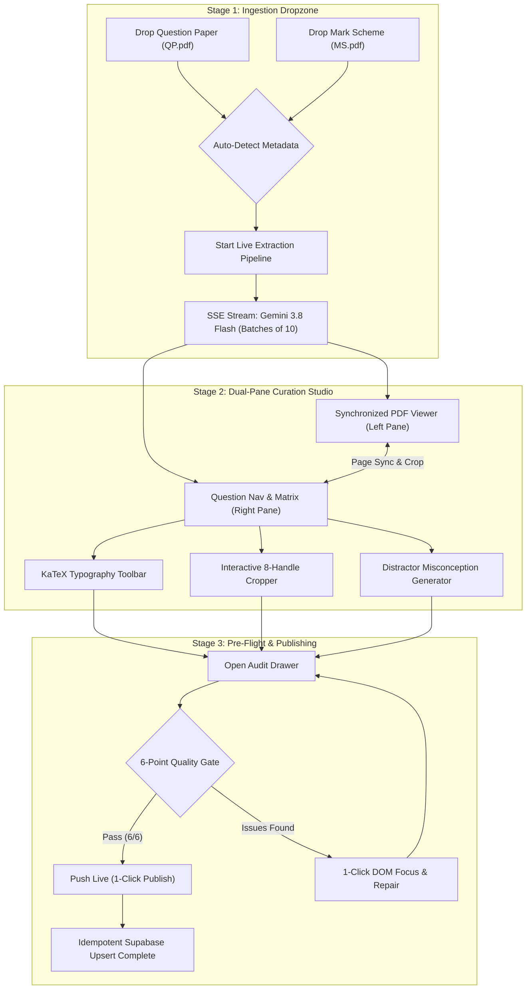

# Revizz Ingestion System v2 — Architecture & Operator Guide

> **Version**: 2.0.0  
> **Status**: Production Reference  
> **Target Audience**: Content Curators, Educators, Platform Engineers, and DevOps Operators  
> **Scope**: Cambridge Assessment International Education (CAIE) MCQ Past Paper Digitization Pipeline  

---

## Executive Summary

**Revizz Ingestion System v2** is a high-throughput, web-based examination ingestion workstation engineered for Cambridge Assessment International Education (CAIE) Multiple Choice Question (MCQ) examinations. Built with Next.js, TypeScript, Tailwind CSS, KaTeX, Sharp, Google Gemini 3.8 Flash Vision, and Supabase, Ingestion v2 replaces manual paper transcription with an automated, pedagogically rigorous, and visually synchronized digitization pipeline.

```
┌────────────────────────────────────────────────────────────────────────────────────────┐
│                        REVIZZ INGESTION SYSTEM v2 ARCHITECTURE                         │
├─────────────────────┬───────────────────────────┬─────────────────────┬────────────────┤
│ 1. Extraction       │ 2. Dual-Pane Studio       │ 3. Quality Gate     │ 4. Publishing  │
│                     │                           │                     │                │
│ • CAIE QP PDF       │ • PDF Viewer (Left)       │ • 6-Point Checklist │ • Subjects     │
│ • CAIE MS PDF       │ • Question Editor (Right) │ • KaTeX AST Linter  │ • Papers       │
│ • Gemini 3.8 Flash  │ • 8-Handle Diagram Crop   │ • Distractor Audit  │ • Topics       │
│ • SSE Progress Stream│ • KaTeX Quick Toolbar    │ • 1-Click DOM Focus │ • Questions    │
│ • Metadata Autodetect│ • Distractor Generator   │ • Copy/Export JSON  │ • Options DB   │
└─────────────────────┴───────────────────────────┴─────────────────────┴────────────────┘
```

---

## 1. Overview & Key Capabilities

Revizz Ingestion v2 addresses five historical bottlenecks in educational paper ingestion: OCR equation corruption, displaced diagram assets, manual mark scheme cross-referencing, lack of distractor pedagogical rationale, and non-atomic database writes.

### Core System Capabilities

| Capability | Technical Implementation | Operational Benefit |
| :--- | :--- | :--- |
| **Direct PDF Drag-and-Drop** | Dual HTML5 dropzone with automatic filename regex parsing (`0455`, `0625`, `0610`, `0620`, series `m/s/w`, year, paper code). | Zero manual form entry; instant metadata inference upon dropping Question Paper (QP) and Mark Scheme (MS). |
| **Dual-Pane Synchronized Studio** | Side-by-side 48%/52% layout with synchronized page navigation, zoom (50%–250%), and pan controls. | Curators verify transcription fidelity directly against the authentic Cambridge exam page in real time. |
| **Interactive Diagram Cropper** | Client-side 8-handle transform widget operating in normalized `[0..1000]` coordinate space, paired with server-side Sharp WebP pipeline. | Millimeter-accurate diagram cropping directly from high-resolution PDF pages with automatic Supabase storage upload. |
| **KaTeX Typography Normalization** | AST-based regex tokenizer escaping currency amounts (`$50` → `\$50`), normalizing delimiters (`\[...\]` → `$$...$$`), standardizing units, and enforcing syntax safety. | Zero client-side KaTeX rendering crashes; robust handling of complex economics, physics, and chemistry equations. |
| **Distractor Misconception Generator** | Cambridge pedagogical heuristics and Gemini AI inference generating structured rationales for options A, B, C, and D. | Explains why the correct key is right and precisely diagnoses student misconceptions, traps, and sign slips for distractors. |
| **6-Point Quality Gate Audit Drawer** | Paper-wide automated validation suite inspecting counts, option integrity, answer keys, KaTeX syntax, diagrams, and syllabus alignment. | Pre-flight validation gate blocking corrupted papers; 1-click smooth scrolling into invalid fields. |
| **Atomic Supabase Publishing** | Relational idempotent upsert across 5 relational tables (`subjects`, `papers`, `topics`, `questions`, `question_options`). | Rollback-safe, multi-tenant persistence with complete receipt logging. |

---

## 2. Workflow Guide for Teachers & Content Editors

The ingestion workflow is divided into three consecutive stages designed for rapid throughput and zero data loss.



### Stage 1: Document Dropzone & Metadata Auto-Detection

1. **Access Ingestion Studio**: Navigate to `/portal` or `/admin` in the Revizz application.
2. **Dropzone Interface**:
   - **Dropzone 1 (Question Paper)**: Drop the official CAIE question paper PDF (e.g., `0455_s24_qp_12.pdf`).
   - **Dropzone 2 (Mark Scheme)**: Drop the corresponding official mark scheme PDF (e.g., `0455_s24_ms_12.pdf`).
3. **Automated Metadata Parsing**:
   The ingestion engine inspects the filename and header structures using heuristic matching:
   - **Subject Code**: `0455` (Economics), `0625` (Physics), `0610` (Biology), `0620` (Chemistry).
   - **Series**: `m` (February/March), `s` (May/June), `w` (October/November).
   - **Year**: Extracted from 2-digit or 4-digit tokens (e.g., `24` → `2024`).
   - **Paper & Variant**: Extracted from tokens (e.g., `12` → Paper 1, Variant 2).
4. **Alternative Ingestion Modes**:
   - **Load Sample Preset**: Click **Load Sample Preset** to load Cambridge Economics `0455_s24_12` for inspection or offline editing.
   - **Upload Pre-staged JSON**: Upload a previously exported `StagingPaper` JSON file.
   - **Start Blank Draft**: Manually author questions from scratch.
5. **Trigger Extraction**: Click **Start Live Extraction Pipeline**.
   - An SSE stream opens against `POST /api/ingest/extract`.
   - Questions are processed in chunks of 10 (`Q1-Q10`, `Q11-Q20`, `Q21-Q30`, `Q31-Q40`) to ensure reliability and prevent API timeouts.
   - A real-time progress banner displays the active batch, percentage complete, and provides a **Cancel Extraction** button.

---

### Stage 2: Dual-Pane Studio & Curation Workspace

Once extraction completes, the studio transitions automatically into the Dual-Pane Curation Workspace.

```
┌────────────────────────────────────────┬────────────────────────────────────────────────────────┐
│ LEFT PANE (48% Width): PDF Reference   │ RIGHT PANE (52% Width): Authoring Suite               │
├────────────────────────────────────────┼───────────────────────┬────────────────────────────────┤
│ [◀ Page 4 of 16 ▶] [Zoom: 100%] [Crop] │ Question Nav (22%)    │ Question Authoring Canvas      │
│ ┌────────────────────────────────────┐ │ ┌───────────────────┐ │ • Citation & Topic Mapping     │
│ │ Question 12                        │ │ │ Q1  [Economics] ● │ │ • Stem Editor (Markdown/KaTeX) │
│ │ A firm faces the following average │ │ │ Q2  [Elasticity]● │ │ • KaTeX Toolbar ($x$, \frac)   │
│ │ revenue and cost curves:           │ │ │ ...               │ │ • 4 MCQ Options Matrix (A-D)   │
│ │                                    │ │ │ Q12 [Cost Curves] │ │ • Radio Button Correct Key     │
│ │ [ 8-HANDLE CROPPING BOX OVERLAY ]  │ │ │ ...               │ │ • Distractor Misconceptions    │
│ │ ┌────────────────────────────────┐ │ │ │ Q40 [Trade]     ● │ │ • Diagram Lightbox & Derivation│
│ │ │ Demand/Supply Curve Diagram    │ │ │ └───────────────────┘ │ • Live Gameboy Preview Drawer  │
│ │ └────────────────────────────────┘ │ │                     │                                │
│ └────────────────────────────────────┘ │ [ + Add Question ]   │ [👁 Preview]    [ Push Live ]  │
└────────────────────────────────────────┴───────────────────────┴────────────────────────────────┘
```

#### 1. Synchronized PDF Viewer (Left Pane)
- **Synchronized Page Jumping**: Selecting a question in the right-hand matrix automatically flips the PDF viewer to that question's source page (`page_number`).
- **Collapsible Rail**: Click the collapse button on the top-right of the PDF pane to collapse it into a slim vertical rail (`w-12`), expanding the authoring canvas to full width. Click the expand button to restore the side-by-side view.
- **Zoom & Pan Controls**: Use `[Zoom In (+)]`, `[Zoom Out (-)]`, and `[Reset (100%)]` (range: 50% to 250%). Toggle **Pan Mode** to drag and inspect high-density typography or small diagrams.

#### 2. Interactive Diagram Cropper
When a question references a graph, diagram, schematic, or table:
- **Activate Crop Overlay**: Click **Crop Diagram** on the PDF toolbar or click on the canvas overlay.
- **8 Drag Handles**: Use the 8 interactive handles to define the crop area:
  - Corners: `NW`, `NE`, `SW`, `SE`
  - Edges: `N`, `S`, `W`, `E`
  - Body Translation: Click inside the bounding box and drag to reposition (`move`).
  - Freeform Draw: Click and drag on empty canvas space to draw a new bounding box (`create`).
- **Normalized Coordinate Space**: Coordinates are normalized to a `[0..1000]` scale (`ymin`, `xmin`, `ymax`, `xmax`, `page_number`).
- **Instant Server-Side Crop**: Click **Confirm Crop**. The client posts the normalized bounding box and page reference to `/api/ingest/crop`. The server executes Sharp rasterization, optimizes to WebP, uploads the asset to Supabase Storage bucket `question-diagrams`, and attaches the resulting public URL to `currentQuestion.diagram.image_url`.

#### 3. KaTeX Typography Toolbar & Validation
Located above the Question Stem Editor and Derivation editor:
- **Quick Insertion Chips**:
  - `Math ($...$)`: Inserts inline LaTeX math delimiter `$x$`.
  - `Fraction (\frac{a}{b})`: Inserts `\frac{a}{b}`.
  - `Exponent (x^2)`: Inserts `^{2}`.
  - `Unit (\text{m/s})`: Inserts scientific text units `\text{m/s}`.
  - `Chemical (\text{CO}_2)`: Inserts chemical notation `\text{CO}_{2}`.
  - `+ More Math`: Popover containing `\times`, `\Delta`, `\%`, `\pm`, `\le`, `\ge`, `\approx`, `\alpha`, `\beta`, and display math blocks `$$...$$`.
- **Currency Protection**: Dollar amounts like `$50` or `$100 million` are automatically sanitized and escaped as `\$50` to prevent KaTeX delimiters from capturing plain English text.
- **Real-Time KaTeX Linter**: Analyzes text on every keystroke. If unmatched delimiters, unclosed braces, or invalid syntax are detected, a red warning badge highlights the error with actionable resolution guidance.

#### 4. 4-Option MCQ Matrix & Distractor Misconceptions
- **Correct Answer Selection**: Click the circular radio badge next to option A, B, C, or D. Exactly one option must be designated as correct.
- **Distractor Misconception Generator**:
  - Under each option card, expand the **Pedagogical Misconception / Distractor Analysis** accordion.
  - Click **Generate Distractor Rationale** to generate a pedagogical rationale:
    - **Correct Option**: Reasserts why this option aligns with Cambridge examiner criteria and syllabus definitions.
    - **Incorrect Distractors (A, B, C, D)**: Explains the exact cognitive trap, formula inversion (e.g., inverting PED formula), curve confusion (shift vs movement along curve), or sign error.
  - Curators can manually edit rationales or regenerate them using Cambridge domain heuristics.

#### 5. Rapid Keyboard Shortcuts
When typing focus is outside an `<input>` or `<textarea>`:

| Key Binding | Action |
| :--- | :--- |
| `1` or `A` | Set Option **A** as the correct answer key. |
| `2` or `B` | Set Option **B** as the correct answer key. |
| `3` or `C` | Set Option **C** as the correct answer key. |
| `4` or `D` | Set Option **D** as the correct answer key. |
| `ArrowUp` / `ArrowLeft` | Select previous question in paper sequence. |
| `ArrowDown` / `ArrowRight` | Select next question in paper sequence. |
| `Home` | Jump to Question 1. |
| `End` | Jump to the final question in the paper. |
| `Escape` | Dismiss active modal, drawer, or lightbox. |
| `Ctrl+Z` / `Cmd+Z` | Undo last edit action (up to 30 history states). |
| `Ctrl+Shift+Z` / `Cmd+Shift+Z` | Redo previously undone action. |

---

### Stage 3: Quality Gate Audit Drawer & 1-Click Publishing

Before publishing to production, papers must pass the **6-Point Quality Gate**.

```
┌────────────────────────────────────────────────────────────────────────┐
│                   QUALITY GATE PRE-FLIGHT AUDIT                        │
├───────────────────────────────────┬──────────────┬─────────────────────┤
│ Check Item                        │ Metric       │ Status              │
├───────────────────────────────────┼──────────────┼─────────────────────┤
│ 1. Total Questions Present        │ 40 / 40      │ [ PASS ]            │
│ 2. Options Validity (A, B, C, D)  │ 40 / 40      │ [ PASS ]            │
│ 3. Correct Key Parity (Exactly 1) │ 40 / 40      │ [ PASS ]            │
│ 4. KaTeX Syntax Integrity         │ 0 Errors     │ [ PASS ]            │
│ 5. Diagram Integrity              │ 6 / 6 Valid  │ [ PASS ]            │
│ 6. Syllabus Alignment             │ 40 / 40      │ [ PASS ]            │
└───────────────────────────────────┴──────────────┴─────────────────────┘
```

#### The 6-Point Quality Gate Checklist

1. **Total Questions Present (`total_questions`)**:
   - Verifies whether the staged batch satisfies the Cambridge standard for the paper code (default: 40 questions for Paper 1 MCQs, 30 for legacy variants).
   - Status: `pass` if count matches; `warn` for partial batch; `fail` if empty.
2. **Options Validity (`options_validity`)**:
   - Verifies that every question possesses exactly 4 options labeled `A`, `B`, `C`, and `D`, and that all option markdown content is non-empty.
   - Status: `pass` if 100% compliant; `fail` if any missing options or blank text exist.
3. **Correct Key Parity (`correct_key_parity`)**:
   - Enforces that strictly **one** option has `is_correct === true`. Zero correct options or multiple correct options trigger a critical failure.
   - Status: `pass` if all questions have exactly 1 correct key; `fail` otherwise.
4. **KaTeX Syntax Integrity (`katex_integrity`)**:
   - Runs full AST compilation via `katex.renderToString` on all stems, options, and derivations.
   - Verifies balanced braces `{...}`, closed display math `$$...$$`, closed inline math `$x$`, and flags unescaped currency signs.
   - Status: `pass` if 0 parse errors; `fail` if syntax errors exist.
5. **Diagram Integrity (`diagram_integrity`)**:
   - Inspects all questions with `diagram.has_diagram === true`. Verifies that a valid image URL (`http://`, `https://`, or `data:image/`) is populated and reachable.
   - Status: `pass` if all flagged diagrams possess valid URLs; `warn` if image URLs are missing.
6. **Syllabus Alignment (`syllabus_alignment`)**:
   - Verifies that every question is mapped to a valid syllabus topic (e.g., "The Basic Economic Problem", "Microeconomic Decision Makers").
   - Flags `unassigned` or `none`.
   - Status: `pass` if 100% assigned; `warn` if unassigned topics remain.

#### Interactive Audit Navigation & 1-Click Repair
- **Filter Chips**: Filter questions by `All`, `Errors`, `Warnings`, `Valid`, `Diagrams`, or `No Explanation`.
- **Search Query**: Real-time text filter across question stems and topics.
- **1-Click DOM Focus**: Clicking on an error card in the audit drawer automatically closes the drawer, navigates to the question, smoothly scrolls to the offending field (`#option-B-content`, `#diagram-alt-description`, `#explanation-textarea`), and sets DOM focus.
- **Export & Copy**:
  - `[Copy JSON Payload]`: Copies the validated `StagingPaper` payload to the clipboard.
  - `[Download JSON]`: Downloads `[paper_id]_staged.json` for backup or offline review.

#### 1-Click Publishing to Supabase
Once the Quality Gate passes, click **`[Push Live]`** in the top navigation bar.
- The client initiates `POST /api/ingest/publish`.
- Performs atomic, relational upserts across Supabase database tables.
- Returns a structured confirmation receipt displaying the number of subjects, papers, topics, questions, and options inserted.

---

## 3. Backend API Reference

### 1. `POST /api/ingest/extract`

Extracts Cambridge questions and matches them against mark scheme answer keys using Gemini 3.8 Flash Multimodal Vision and OCR.

- **Route Runtime**: `nodejs`
- **Dynamic Mode**: `force-dynamic`
- **Authentication**: `GEMINI_API_KEY` via server environment or `x-gemini-api-key` request header.

#### Request Headers
```http
POST /api/ingest/extract HTTP/1.1
Host: revizz.app
Content-Type: multipart/form-data
x-gemini-api-key: [OPTIONAL_OVERRIDE_KEY]
```

#### Request Parameters & Body Modes

##### Mode A: `multipart/form-data` (Direct Browser Upload)
| Field | Type | Description |
| :--- | :--- | :--- |
| `qp` | File (PDF) | CAIE Question Paper PDF file (**Required**). |
| `ms` | File (PDF) | CAIE Mark Scheme PDF file (**Required**). |
| `batch_size` | number | Questions per Gemini batch (default: `10`, range: `1..20`). |
| `start_question`| number | First question number to extract (default: `1`). |
| `end_question` | number | Final question number to extract (default: `40`). |
| `model` | string | Gemini model identifier (default: `'gemini-3.8-flash'`). |
| `stream` | boolean | Set `true` for SSE progress streaming (default: `true`). |

##### Mode B: `application/json` (Base64 Payloads)
```json
{
  "qp_base64": "JVBERi0xLjQKJeLjz9MK...",
  "ms_base64": "JVBERi0xLjQKJeLjz9MK...",
  "source_qp_filename": "0455_s24_qp_12.pdf",
  "source_ms_filename": "0455_s24_ms_12.pdf",
  "batch_size": 10,
  "start_question": 1,
  "end_question": 40,
  "model": "gemini-3.8-flash",
  "stream": true
}
```

#### Response Formats

##### A. Streaming Response (`stream=true`, Default)
- **Content-Type**: `text/event-stream`
- **Cache-Control**: `no-cache, no-transform`

```
event: message
data: {"stage":"extracting","currentBatch":"Q1-Q10","percent":25,"batchCount":1,"questions":[...]}

event: message
data: {"stage":"extracting","currentBatch":"Q11-Q20","percent":50,"batchCount":2,"questions":[...]}

event: message
data: {"stage":"extracting","currentBatch":"Q21-Q30","percent":75,"batchCount":3,"questions":[...]}

event: message
data: {"stage":"extracting","currentBatch":"Q31-Q40","percent":100,"batchCount":4,"questions":[...]}

event: done
data: {"success":true,"total_questions":40}
```

##### B. Non-Streaming JSON Response (`stream=false`)
- **Content-Type**: `application/json`
- **Status**: `200 OK`

```json
{
  "success": true,
  "total_questions": 40,
  "questions": [
    {
      "question_number": 1,
      "page_number": 2,
      "stem_markdown": "What is meant by the basic economic problem?",
      "options": [
        { "label": "A", "content_markdown": "finite resources and infinite wants", "is_correct": true },
        { "label": "B", "content_markdown": "inflation and unemployment", "is_correct": false },
        { "label": "C", "content_markdown": "market failure and government intervention", "is_correct": false },
        { "label": "D", "content_markdown": "recession and economic growth", "is_correct": false }
      ],
      "distractor_analysis": {
        "A": "Unequivocally correct: Scarcity is the fundamental conflict between limited resources and unlimited human desires.",
        "B": "Pedagogical misconception: Confuses macroeconomic policy problems with the foundational definition of scarcity.",
        "C": "Distractor: Confuses microeconomic allocative inefficiency with foundational scarcity.",
        "D": "Distractor: Focuses on business cycles rather than the permanent condition of scarcity."
      },
      "explanation_markdown": "### Fundamental Concepts\nThe basic economic problem is scarcity...",
      "diagrams": []
    }
  ]
}
```

#### Example cURL Command
```bash
curl -X POST https://revizz.app/api/ingest/extract \
  -H "x-gemini-api-key: AIzaSy..." \
  -F "qp=@./papers/0455_s24_qp_12.pdf" \
  -F "ms=@./papers/0455_s24_ms_12.pdf" \
  -F "batch_size=10" \
  -F "stream=false"
```

---

### 2. `POST /api/ingest/crop`

Crops a high-resolution diagram region from an image or PDF raster page, optimizes the output to WebP, and uploads the asset to Supabase Storage.

- **Route Runtime**: `nodejs`
- **Dynamic Mode**: `force-dynamic`

#### Request Body (`application/json`)
```json
{
  "imageBase64": "data:image/png;base64,iVBORw0KGgo...",
  "imageUrl": "https://[project-id].supabase.co/storage/v1/object/public/question-diagrams/raw_page_4.png",
  "bbox": {
    "ymin": 210,
    "xmin": 140,
    "ymax": 580,
    "xmax": 860,
    "page_number": 4
  },
  "paperCode": "0455_s24_12",
  "questionNumber": 12
}
```

| Parameter | Type | Required | Description |
| :--- | :--- | :--- | :--- |
| `imageBase64` | string | Optional* | Base64-encoded image string (*Either `imageBase64` or `imageUrl` required). |
| `imageUrl` | string | Optional* | Accessible URL to raw page raster image. |
| `bbox` | `BoundingBox` | **Required** | Normalized bounding box coordinates `[0..1000]`. |
| `paperCode` | string | **Required** | Unique paper composite code (e.g. `"0455_s24_12"`). |
| `questionNumber`| number | **Required** | Question number (positive integer, e.g. `12`). |

#### Response (`200 OK`)
```json
{
  "success": true,
  "url": "https://dmvahcaxixvhgxidmkqs.supabase.co/storage/v1/object/public/question-diagrams/0455_s24_12/q12.webp",
  "storage_path": "0455_s24_12/q12.webp",
  "bbox": {
    "ymin": 210,
    "xmin": 140,
    "ymax": 580,
    "xmax": 860,
    "page_number": 4
  }
}
```

#### Error Response (`400 Bad Request`)
```json
{
  "success": false,
  "error": "Invalid, degenerate, or missing bounding box coordinates.",
  "bbox": { "ymin": 100, "xmin": 100, "ymax": 100, "xmax": 100, "page_number": 4 }
}
```

#### Example cURL Command
```bash
curl -X POST https://revizz.app/api/ingest/crop \
  -H "Content-Type: application/json" \
  -d '{
    "imageUrl": "https://revizz.app/sample-pages/page4.png",
    "paperCode": "0455_s24_12",
    "questionNumber": 12,
    "bbox": { "ymin": 200, "xmin": 150, "ymax": 600, "xmax": 850, "page_number": 4 }
  }'
```

---

### 3. `POST /api/ingest/publish`

Performs an atomic, relational, idempotent upsert of a validated `StagingPaper` into Supabase database tables.

- **Route Runtime**: `nodejs`
- **Dynamic Mode**: `force-dynamic`

#### Request Body (`application/json`)
```json
{
  "paper": {
    "id": "0455_s24_12",
    "subject": { "code": "0455", "name": "Economics", "icon": "📈" },
    "paper": { "year": 2024, "series": "s", "paper_code": "12" },
    "syllabus_topics": [
      { "name": "The Basic Economic Problem", "order_index": 1 },
      { "name": "The Allocation of Resources", "order_index": 2 }
    ],
    "questions": [
      {
        "question_number": 1,
        "cambridge_source_ref": "0455/12/M/J/24 Q1",
        "topic_name": "The Basic Economic Problem",
        "stem_markdown": "What is an opportunity cost?",
        "options": [
          { "label": "A", "content_markdown": "The next best alternative forgone", "is_correct": true },
          { "label": "B", "content_markdown": "Total monetary expenditure", "is_correct": false },
          { "label": "C", "content_markdown": "Fixed capital depreciation", "is_correct": false },
          { "label": "D", "content_markdown": "Direct accounting expense", "is_correct": false }
        ],
        "distractor_analysis": {
          "A": "Direct textbook definition of opportunity cost.",
          "B": "Confuses economic opportunity cost with explicit monetary outlay.",
          "C": "Confuses capital consumption with forgone alternatives.",
          "D": "Excludes implicit opportunity costs."
        },
        "explanation_markdown": "### Concept\nOpportunity cost is the benefit forgone...",
        "diagram": { "has_diagram": false },
        "status": "active"
      }
    ]
  },
  "publish_options": {
    "selected_question_numbers": [1, 2, 3]
  }
}
```

#### Relational Upsert Transaction Flow
1. **Validation**: Runs `validateStagingPaper(paper, { allowPartialBatch: true })`.
2. **Subject Upsert**: Upserts into `public.subjects` on conflict (`code`).
3. **Paper Upsert**: Upserts into `public.papers` on conflict (`subject_id, year, series, paper_code`).
4. **Topics Upsert**: Synchronizes topics in `public.topics` on conflict (`subject_id, name`).
5. **Questions Upsert**: Upserts questions into `public.questions` on conflict (`paper_id, question_number`).
6. **Options Upsert**: Replaces options in `public.question_options` on conflict (`question_id, label`), persisting distractor reasoning from `distractor_analysis` into `distractor_reasoning`.

#### Response (`200 OK`)
```json
{
  "success": true,
  "paper_id": "8d3e9114-124b-4a5c-9c76-5fae0e527012",
  "subjects_count": 1,
  "topics_count": 2,
  "questions_count": 40,
  "options_count": 160
}
```

#### Example cURL Command
```bash
curl -X POST https://revizz.app/api/ingest/publish \
  -H "Content-Type: application/json" \
  -d @./staging_paper_payload.json
```

---

## 4. Data Schemas & TypeScript Definitions

All schemas are declared using [Zod](https://zod.dev) in `@/types/ingestion.ts`.

### TypeScript Interface Reference

```typescript
import { z } from 'zod';

/**
 * Normalized coordinates of a diagram crop within a PDF page (0..1000 scale).
 */
export const BoundingBoxSchema = z.object({
  ymin: z.number().min(0).max(1000),
  xmin: z.number().min(0).max(1000),
  ymax: z.number().min(0).max(1000),
  xmax: z.number().min(0).max(1000),
  page_number: z.number().int().positive(),
});
export type BoundingBox = z.infer<typeof BoundingBoxSchema>;

/**
 * Diagram extraction and storage metadata.
 */
export const DiagramMetadataSchema = z.object({
  has_diagram: z.boolean(),
  bounding_box: BoundingBoxSchema.optional(),
  image_url: z.string().optional(),
  storage_path: z.string().optional(),
  alt_description: z.string().optional(),
});
export type DiagramMetadata = z.infer<typeof DiagramMetadataSchema>;

/**
 * MCQ Option label ('A' | 'B' | 'C' | 'D').
 */
export const OptionLabelSchema = z.enum(['A', 'B', 'C', 'D']);
export type OptionLabel = z.infer<typeof OptionLabelSchema>;

/**
 * Single option in a staging question.
 */
export const StagingOptionSchema = z.object({
  label: OptionLabelSchema,
  content_markdown: z.string().min(1, 'Option content cannot be empty.'),
  is_correct: z.boolean(),
});
export type StagingOption = z.infer<typeof StagingOptionSchema>;

/**
 * Staged question from the Cambridge ingestion pipeline.
 */
export const StagingQuestionSchema = z.object({
  question_number: z.number().int().positive(),
  cambridge_source_ref: z.string().optional().default(''),
  topic_name: z.string().optional().default('General'),
  stem_markdown: z.string().min(1, 'Stem markdown is required.'),
  diagram: DiagramMetadataSchema.optional(),
  diagrams: z.array(BoundingBoxSchema).optional(),
  options: z.array(StagingOptionSchema).length(4, 'Must have exactly 4 options A-D.'),
  explanation_markdown: z.string().default(''),
  status: z.enum(['active', 'withdrawn']).optional().default('active'),
  page_number: z.number().int().positive().optional(),
  distractor_analysis: z.record(z.string(), z.string()).optional(),
  validation_status: z.enum(['valid', 'warning', 'error']).optional(),
});
export type StagingQuestion = z.infer<typeof StagingQuestionSchema>;

/**
 * Subject metadata.
 */
export const StagingSubjectSchema = z.object({
  code: z.string(),
  name: z.string(),
  icon: z.string(),
});
export type StagingSubject = z.infer<typeof StagingSubjectSchema>;

/**
 * Paper metadata.
 */
export const StagingPaperMetaSchema = z.object({
  series: z.string(),
  paper_code: z.string(),
  year: z.number().int(),
});
export type StagingPaperMeta = z.infer<typeof StagingPaperMetaSchema>;

/**
 * Syllabus topic item.
 */
export const StagingSyllabusTopicSchema = z.object({
  name: z.string(),
  order_index: z.number().int(),
});
export type StagingSyllabusTopic = z.infer<typeof StagingSyllabusTopicSchema>;

/**
 * Complete Cambridge MCQ staging paper document.
 */
export const StagingPaperSchema = z.object({
  id: z.string().optional(),
  lifecycle_state: z.enum(['draft', 'extracting', 'review', 'published']).optional(),
  state: z.enum(['draft', 'extracting', 'review', 'published']).optional(),
  source_qp_filename: z.string().optional(),
  source_ms_filename: z.string().optional(),
  total_pages: z.number().int().positive().optional(),
  detected_year: z.number().int().optional(),
  detected_series: z.string().optional(),
  detected_paper_code: z.string().optional(),
  subject: StagingSubjectSchema,
  paper: StagingPaperMetaSchema,
  syllabus_topics: z.array(StagingSyllabusTopicSchema),
  questions: z.array(StagingQuestionSchema),
});
export type StagingPaper = z.infer<typeof StagingPaperSchema>;
```

### Validation Functions (`validateStagingPaper`, `validateStagingQuestion`)

- `validateStagingQuestion(data: unknown): ValidationResult<StagingQuestion>`: Validates that options array has length 4, labels are exactly A, B, C, D, and at least one option is marked correct.
- `validateStagingPaper(data: unknown, options?: ValidatePaperOptions): ValidationResult<StagingPaper>`: Validates the entire document, verifies the question count (default: 40 questions, or custom if `allowPartialBatch: true`), and validates each question individually.

---

## 5. Production Deployment & Cloud Boundary Checklist

Deploying Revizz Ingestion System v2 requires managing execution timeouts, memory ceilings for PDF rendering, binary native bindings, and Supabase security rules across cloud providers.

### Architecture Topology: Vercel vs Railway

```
┌──────────────────────────────────────────────┐       ┌──────────────────────────────────────────────┐
│ VERCEL (Serverless Next.js Edge / Node)      │       │ RAILWAY / CONTAINER (Dedicated Node Worker)  │
├──────────────────────────────────────────────┤       ├──────────────────────────────────────────────┤
│ • Ingestion Studio UI & Client Components    │       │ • Long-Running PDF Parsing (> 60s)           │
│ • Client State Store (useSyncExternalStore)  │       │ • High-Memory Sharp Native Image Processing  │
│ • KaTeX AST Linter (Client-side fast feedback)│      │ • Full 40-Question Multimodal Batches        │
│ • Idempotent Publish Route (/publish)        │       │ • Uncapped Payload Body Limits (> 50MB)      │
│ • Diagram Crop Route (/crop)                 │       │ • Dedicated Worker Queue                     │
└──────────────────────────────────────────────┘       └──────────────────────────────────────────────┘
```

### Cloud Boundary Matrix

| Constraint | Vercel Serverless Function | Railway Container / Node Worker | Recommended Revizz Policy |
| :--- | :--- | :--- | :--- |
| **Max Execution Duration** | Hobby: 10s / Pro: 60s / Enterprise: 300s | Unlimited (background process) | Ingestion extraction route uses batching (`batch_size=10`) with SSE streaming to stay well within standard function windows. For full 40-question batching in a single call, delegate to the Railway worker. |
| **Max Request Body Size** | 4.5 MB (Serverless payload cap) | Unlimited | Client uploads PDF via FormData or directly to Supabase Storage, passing public URLs or presigned URLs to extraction routes. |
| **Native Binaries (`sharp`, `pdf2pic`)** | Supports Sharp Linux x64 binaries via standard npm install | Full Dockerfile / Alpine container control | Ensure `sharp` is listed in `package.json` dependencies (not devDependencies) and Next.js `output: 'standalone'` is enabled. |
| **Memory Ceiling** | 1024 MB – 3008 MB | Configurable (2GB – 8GB) | Keep Sharp buffer allocations constrained to single pages during diagram crop operations. |

### Environment Variables Checklist

Ensure the following environment variables are set in production:

```env
# Google Gemini Multimodal Vision API
GEMINI_API_KEY="AIzaSy..."

# Supabase Database & Storage Connectivity
NEXT_PUBLIC_SUPABASE_URL="https://[project-id].supabase.co"
NEXT_PUBLIC_SUPABASE_ANON_KEY="eyJhbGciOiJIUzI1NiIsInR5cCI6IkpXVCJ9..."
SUPABASE_SERVICE_ROLE_KEY="eyJhbGciOiJIUzI1NiIsInR5cCI6IkpXVCJ9..."

# Deployment Environment
NODE_ENV="production"
NEXT_TELEMETRY_DISABLED="1"
```

### Supabase Storage Bucket Setup (`question-diagrams`)

1. **Create Bucket**:
   Create a storage bucket named `question-diagrams`.
2. **Access Policy**:
   Enable **Public read access** so diagram images can be served directly to student clients without signing overhead.
3. **Storage RLS Policies**:
   ```sql
   -- Allow authenticated editors and service role to upload diagram images
   CREATE POLICY "Allow authenticated uploads to question-diagrams"
   ON storage.objects FOR INSERT
   TO authenticated, service_role
   WITH CHECK (bucket_id = 'question-diagrams');

   -- Allow public read access to all users
   CREATE POLICY "Allow public read access to question-diagrams"
   ON storage.objects FOR SELECT
   TO public
   USING (bucket_id = 'question-diagrams');
   ```

### WebSocket Polyfill in Node.js Server Runtime
When importing `@supabase/supabase-js` inside Node server runtimes (e.g. Next.js route handlers), older Node environments may lack a native `WebSocket` constructor. Both `/api/ingest/crop/route.ts` and `/api/ingest/publish/route.ts` include the following guard:
```typescript
if (typeof (globalThis as any).WebSocket === 'undefined') {
  (globalThis as any).WebSocket = class MockWebSocket {};
}
```

---

## 6. Verification & Automated Test Commands

Before committing changes or cutting a production release of the ingestion system, execute the verification suite:

```bash
# 1. Verify Ingestion Navigation, Question Validation & Diagram Detection
npx tsx scripts/verify-ingestion-nav.ts

# 2. Verify Schema Definitions, Option Validation & Cambridge Format Rules
npx tsx scripts/verify-ingestion.ts

# 3. Run Jest / Vitest Core Test Suite (Mastery, Auth, KaTeX Sanitizer)
npm test
```

### Verification Verification Checklist
- [x] All 4 tests in `scripts/verify-ingestion-nav.ts` pass (`Valid question`, `Missing Stem`, `3 options error`, `0 correct options error`).
- [x] KaTeX sanitizer tests pass with 0 unhandled exceptions.
- [x] Diagram cropper handles degenerate bounding boxes gracefully.
- [x] Idempotent upsert logic protects against duplicated question entries.

---

*Authored by Revizz Core Platform Engineering & Content Ingestion Team.*
